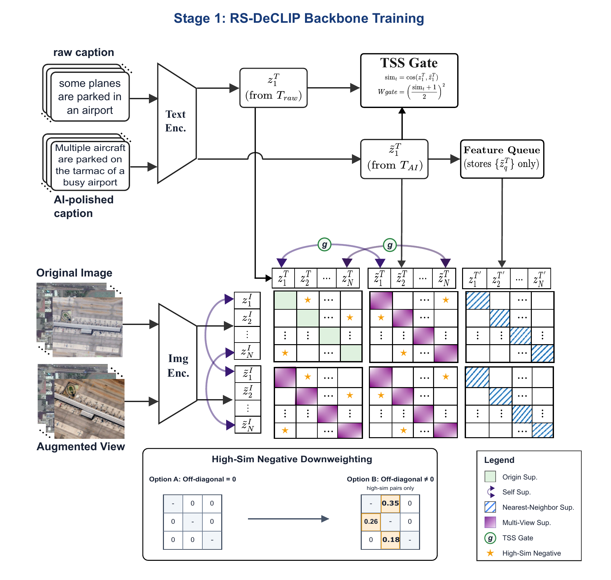
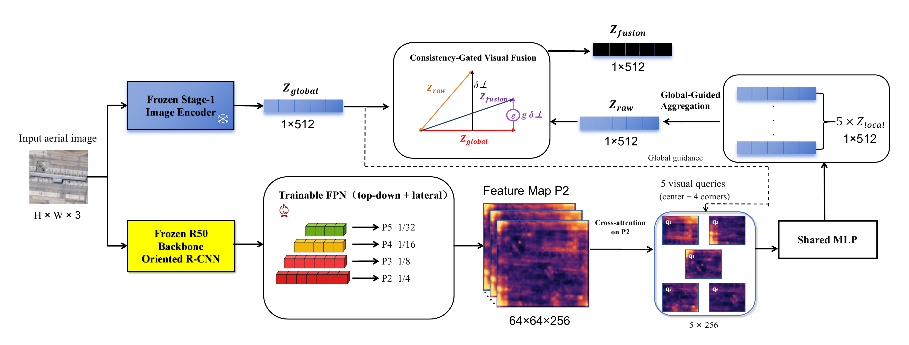

# RS-DeCLIP

**Gated Dual-Source DeCLIP Adaptation with Side-Branch Query-Based Local Fusion for Remote Sensing Image-Text Retrieval**

RS-DeCLIP is a two-stage framework for retrieving remote sensing images from natural-language descriptions and retrieving descriptions for an image. It adapts a RemoteCLIP ViT-B/32 dual encoder and complements its global representations with local visual evidence while retaining standard embedding-based retrieval.

Remote sensing scenes often contain small objects, repeated layouts, and complex spatial relationships. Their captions can also be repetitive: adding rewritten descriptions increases linguistic variation, but can change object counts, attributes, or spatial relations. RS-DeCLIP addresses these issues in two steps. Stage 1 improves global image-text adaptation with reliability-aware textual supervision. Stage 2 adds local visual information without requiring text-dependent image processing during retrieval.

## Framework

### Stage 1: Gated dual-source adaptation

Original and augmented images share the image encoder, while official captions and LLM-polished captions provide complementary textual views. DeCLIP-style multi-view supervision is combined with a detached semantic-consistency gate, high-similarity negative downweighting, and text-to-image-aware loss weighting. Bidirectional cross-attention, adaptive detail cross-modal alignment (ADCA), and counterfactual detail ranking provide additional training supervision. These auxiliary modules are discarded at inference, leaving independently deployable image and text encoders.



### Stage 2: Query-based local refinement

The Stage-1 encoders remain frozen. A parallel Oriented R-CNN R50 backbone, also frozen, and a trainable FPN produce a dense P2 feature map. Five learnable visual queries receive a small global-image contribution and read P2 with soft preferences around the center and four corners. Their local tokens share a projection into the retrieval space and are aggregated under global-image guidance. Consistency-gated orthogonal residual fusion (CGVF) then injects complementary local information into the global embedding.

The visual queries do not depend on the search text. The resulting 512-dimensional image descriptor can therefore be precomputed and indexed, and retrieval still uses a dot product with the normalized text embedding.



## Results reported in the paper

| Dataset | Stage-1 MR (%) | Stage-2 MR (%) |
| --- | ---: | ---: |
| RSICD | 38.54 | **39.27** |
| RSITMD | 50.90 | **52.58** |

On RSICD, Stage 1 improves MR from the RemoteCLIP baseline of 35.26 to 38.54. Stage 2 provides an additional local-refinement gain on both datasets. MR is the mean of I2T and T2I recall at 1, 5, and 10.

## Code

This repository contains the core PyTorch modules, algorithm pseudocode, evaluation and caption-polishing utilities, and AI-polished annotations.

## Contents

| File | Purpose |
| --- | --- |
| `rs_declip/stage1.py` | Dual-source objectives, detached consistency gate, semantic negative weighting, cross-attention, ADCA, and counterfactual ranking |
| `rs_declip/stage2.py` | Five-query V2 reader, soft spatial anchors, global-guided aggregation, CGVF, and training objective |
| `rs_declip/extractor.py` | Oriented R-CNN R50-FPN feature adapter |
| `docs/algorithms.md` | Training and inference pseudocode |
| `examples/core_usage.py` | Small tensor-level forward/backward example |
| `tools/enrich.py` | Caption polishing with credentials and service URL supplied through environment variables |
| `prompts/enrich.txt` | Original caption-polishing prompt |
| `annotations/` | AI-polished training captions separated by dataset |
| `eval.py` | Single-checkpoint evaluation of the RemoteCLIP / Stage-1 dual encoder |

## Installation and example

Use Python 3.10 or newer and install matching PyTorch and torchvision builds for your platform:

```sh
pip install -r requirements.txt
python -m examples.core_usage
```

The example uses synthetic features to demonstrate tensor shapes and the training objective. Dataset loading, full experiment drivers, source images, and pretrained weights are external to this core implementation.

## Polished training captions

| Dataset | Images | Captions | Annotation file |
| --- | ---: | ---: | --- |
| RSICD | 8734 | 43670 | `annotations/RSICD/train_polished.json` |
| RSITMD | 4291 | 21455 | `annotations/RSTIMD/train_polished.json` |

The two training files retain the original captions and metadata and carry a `dataset_source` tag. Every record in `train_polished.json` has `split: train`. The directory spelling `RSTIMD` follows the supplied folder; the dataset name is RSITMD. The supplied complete RSITMD file, `annotations/RSTIMD/dataset_RSITMD_Polished.json`, is also retained with its original 4291 training and 452 test records. Use the extracted training file for training, and the original raw-caption annotations for evaluation. Image files remain in the respective original datasets. For joint training, retain the dataset source in image identities.

To generate additional polished captions, install the optional dependency:

```sh
pip install -r requirements-enrich.txt
python -m tools.enrich --input raw_train.json --output train_polished.json
```

Set `OPENAI_API_KEY` and `OPENAI_BASE_URL` in your local environment before running the command. `.env.example` lists the variable names; the script reads the process environment and does not automatically load an environment file. The model defaults to `deepseek-ai/DeepSeek-V3` and can be changed with `ENRICH_MODEL` or `--model`. The original prompt is stored separately, unchanged, and the request temperature remains 0.3. The script deduplicates caption groups, preserves image metadata, caches successful requests, and leaves non-training captions unchanged.

## Stage-1 checkpoint

`NOW_BEST_R1_21.04.pt` is the Stage-1 checkpoint. Publish it separately as a GitHub Release asset rather than committing it to Git. See [checkpoint information](docs/checkpoints.md) for its checksum. The pretrained checkpoints are not included in the source ZIP.

## Evaluation

Install the optional evaluation dependencies and supply the checkpoint, original raw-caption annotation file, and image directory:

```sh
pip install -r requirements-eval.txt
python eval.py --checkpoint checkpoint.pt --json-path original_dataset.json --image-root images
```

The evaluator uses `split: test`, `raw.capitalize()`, the fixed prompt `An aerial satellite image of `, normalized global embeddings, and the original `clip_benchmark` recall calculation. It reports I2T and T2I R@1/R@5/R@10 and their six-metric mean recall. Paths are command-line arguments. One invocation evaluates one checkpoint; the script contains no optimizer, parameter sweep, or best-checkpoint selection. This entry point evaluates RemoteCLIP / Stage-1 only and does not apply the Stage-2 side branch. AI-polished captions in `annotations/` are not the evaluation inputs.

## Stage 1

Use an OpenAI-CLIP-compatible ViT-B/32 model loaded with RemoteCLIP weights. `Stage1Objective` accepts two image views, one AI-polished caption, one raw caption of the same image, and an optional counterfactual caption indicated by a validity mask. Build the clipped BM25-IDF prior from training captions using `build_clipped_bm25_idf` before constructing the objective. Tokenization should retain the model's context limit and truncate overlong captions.

After the optimizer step, update `objective.memory_bank` with `outputs["text_features"]`. At inference, use only the normalized global image and text embeddings from the adapted dual encoder.

## Stage 2

The side image is resized to 256 x 256 and normalized with the original detector preprocessing: RGB mean `[0.485, 0.456, 0.406]` and standard deviation `[0.229, 0.224, 0.225]`. The CLIP branch uses its own preprocessing. Keep the Stage-1 image and text encoders in evaluation mode with gradients disabled.

Supply a complete Oriented R-CNN detector checkpoint containing both `backbone.*` and `neck.*` weights to `OrientedRCNNR50FPNFeatureExtractor(checkpoint_path, train_backbone=False, train_fpn=True)`. An ImageNet backbone-only checkpoint does not contain the required pretrained FPN weights. The checkpoint is read as a tensor state dictionary; detection-head weights are unused. P2 is the first returned feature map.

Feed P2 and the normalized Stage-1 global descriptor to `P2QueryCGVF`. Its five anchors are initialized at the center and four corners, and bounded offsets provide soft spatial preferences. Each query can attend to every P2 position. Five projected local tokens are aggregated into one descriptor, and CGVF injects their orthogonal residual into the global feature. There is no query-to-query self-attention or multi-scale routing in this version.

Stage-2 training uses the raw captions associated with each image. Pass normalized text and global image features to `stage2_objective`, together with a boolean `[number_of_texts, number_of_images]` positive mask. Each text belongs to one image; each image can have multiple positive captions. `epoch` starts at 1 and retains the original two-epoch score warmup. Inference directly uses the fused descriptor without the warmup blend.

The source configuration uses AdamW, a 2e-5 learning rate for the query/fusion modules, a 1e-6 learning rate for the FPN, weight decay 1e-4, gradient clipping at 1.0, and a 40-epoch cosine schedule with minimum learning rate 1e-6. The R50 backbone remains frozen. Process the side branch in chunks of 16 to retain the original memory usage pattern.

## Upstream projects

See [THIRD_PARTY.md](THIRD_PARTY.md) for the external model and framework projects. Source images and checkpoints are not included in the source ZIP.
